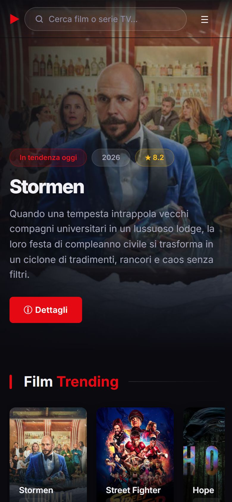

# movieApp 🎬

[](https://github.com/AlexandruD18/movieapp-dimofte/actions/workflows/ci.yml)

A Netflix-style web app to browse movies and TV series with live data from [TMDB](https://www.themoviedb.org/).
It is built with **plain HTML, CSS and JavaScript** (ES modules): no framework and no build step. It is covered by unit, end-to-end and accessibility tests.

**[▶ Live demo](https://alexandrud18.github.io/movieapp-dimofte/)** · [Leggi in italiano](README.it.md)


| Title detail | Where to watch, cast, details |
|---|---|
|  |  |

| Mobile | Mobile detail |
|---|---|
|  |  |

> The interface is in Italian: the app targets Italian users and shows Italian titles, plots and streaming services.

---

## Features

- **Home**: a rotating hero with today's trending movies, carousels of trending movies and series, and a top-rated grid
- **Movies / TV series**: popular, now playing and on-the-air lists with "load more" pagination
- **Live search** in the navbar: debounced suggestions with full keyboard support (↑ ↓ Enter Esc)
- **Detail popup**:
  - rating ring, genres, director or creators, release date, budget and box office
  - **where to watch in Italy** (subscription, rent, buy), from JustWatch data
  - cast with photos, seasons for series, an embedded YouTube trailer and recommended titles
  - a share button
- **Shareable URLs**: `index.html#movie-27205` opens a title directly, and the browser **back button closes the popup**
- **My list**: favorites saved in `localStorage` and synced across open tabs, with filters and computed stats (average rating, hours of content)
- **Responsive and accessible**: mobile menu, full-screen popup on phones, keyboard navigation, visible focus, WCAG 2 AA checked with axe
- **Loading and error states**: skeletons, clear messages (invalid key, offline, rate limit) and a "Retry" button

## Technical highlights

| Topic | What I did |
|---|---|
| Architecture | ES modules with a single job each: `api.js` (network), `detail.js` (popup content), `modal.js` (popup lifecycle and history), `favorites.js`, `layout.js` (shared header/search), plus one script per page |
| Network | In-memory request cache: the hero and the carousel share one `/trending` call. Errors are not cached, so "Retry" actually refetches. The detail view loads credits, videos, providers and recommendations in **one** request via `append_to_response` |
| Race conditions | Search and popup ignore responses that arrive after a newer request |
| History | The popup pushes a history entry: Back closes it, and a recommended title replaces the entry instead of stacking new ones |
| DOM | Event delegation (one listener for every card, including cards added later). External data only goes through `textContent`, never `innerHTML` |
| Native platform | `<dialog>` for focus trap and Esc, container queries for narrow cards, `srcset` for posters, `fetchpriority` for the LCP image, `Intl` for dates, languages and currency |
| Secrets | The API key lives in a git-ignored `js/config.js`. In production it is injected from a GitHub secret at deploy time |

## Quality

- **42 unit tests** (Vitest + jsdom): formatting, API client (cache, errors, missing key), favorites, detail rendering
- **19 end-to-end tests** (Playwright, desktop and mobile): every page, the popup (keyboard, Back button, deep links, trailer, recommendations), search, my list, error and retry, plus **axe accessibility scans** of the pages and the open popup
- E2E tests run against **recorded TMDB responses** ([`scripts/record-fixtures.js`](scripts/record-fixtures.js)): fast, deterministic, and no API key needed in CI
- **ESLint** and **html-validate** on every push. Deploy to GitHub Pages runs only after CI passes
- **Lighthouse**, home page: Performance 98 desktop / ~87 mobile, Accessibility 100, Best Practices 100, SEO 100

## Project structure

```
├── index.html, movies.html, series.html, profile.html
├── css/style.css            # design tokens (custom properties) + components
├── assets/                  # favicon, screenshots
├── js/
│   ├── api.js               # TMDB client: cache, errors, endpoints
│   ├── config-loader.js     # loads the git-ignored API key
│   ├── utils.js             # cards, skeletons, error states, paged grids
│   ├── layout.js            # header, mobile menu, search, card clicks
│   ├── modal.js             # popup lifecycle, URL hash, back button
│   ├── detail.js            # popup content + pure formatting helpers
│   ├── favorites.js         # "My list" on localStorage
│   └── pages/               # home.js, movies.js, series.js, profile.js
├── tests/
│   ├── unit/                # Vitest
│   └── e2e/                 # Playwright + fixtures
├── scripts/record-fixtures.js
└── .github/workflows/       # ci.yml, deploy.yml
```

## TMDB endpoints

| Page | Endpoint |
|---|---|
| Home | `/trending/movie/day`, `/trending/tv/day`, `/movie/top_rated` |
| Movies | `/movie/popular`, `/movie/now_playing` |
| TV series | `/tv/popular`, `/tv/on_the_air` |
| Detail | `/movie/{id}`, `/tv/{id}` + `append_to_response=credits,videos,watch/providers,recommendations` |
| Search | `/search/multi` |

## Run locally

1. Get a free API key (v3) at [themoviedb.org](https://www.themoviedb.org/settings/api)
2. Copy `js/config.example.js` to `js/config.js` and paste your key
3. Install the dev tools and start a static server (ES modules don't work over `file://`):

```bash
npm install
npm run dev          # http://127.0.0.1:4173
```

| Command | What it does |
|---|---|
| `npm run lint` | ESLint + HTML validation |
| `npm test` | Unit tests |
| `npm run test:e2e` | End-to-end + accessibility tests |
| `npm run check` | All of the above |
| `node scripts/record-fixtures.js` | Re-record the TMDB fixtures used by the E2E tests |

## Deploy

[`deploy.yml`](.github/workflows/deploy.yml) publishes the site to GitHub Pages after CI passes on `master`:

1. **Settings → Secrets and variables → Actions**: add a `TMDB_API_KEY` secret
2. **Settings → Pages → Source**: select **GitHub Actions**

In a frontend-only app, the key is still visible in browser requests. For a read-only TMDB key that is acceptable. Hiding it would need a small server-side proxy.

## Background

The project started as the final exam of an *Introduction to Frontend Development* course ([assignment, in Italian](docs/TRACCIA-ESAME.md)). I then extended it with search, the detail view, a personal list, accessibility, automated tests and CI/CD.

## Author

**Alexandru Dimofte** · [GitHub](https://github.com/AlexandruD18)

---

<sub>This product uses the TMDB API but is not endorsed or certified by TMDB. Streaming availability data provided by JustWatch.</sub>
