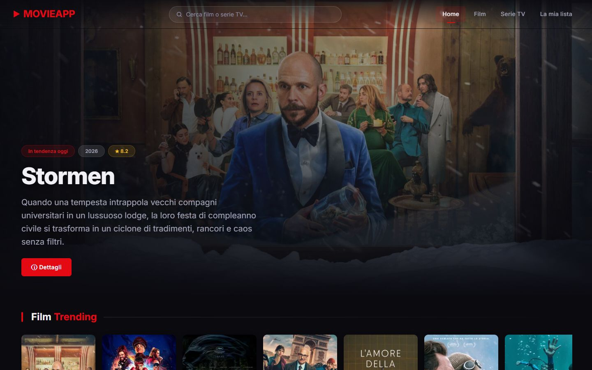
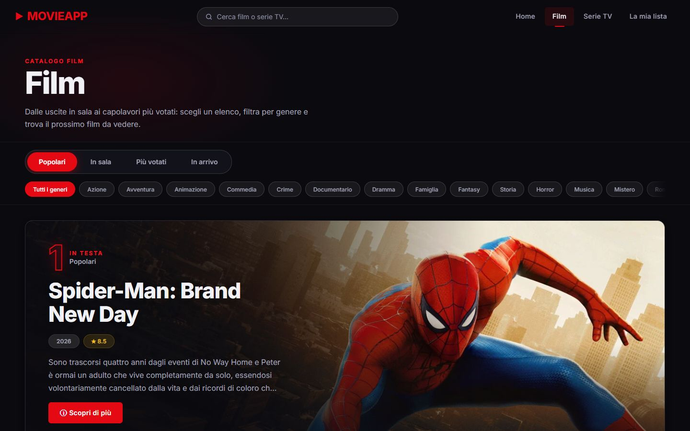
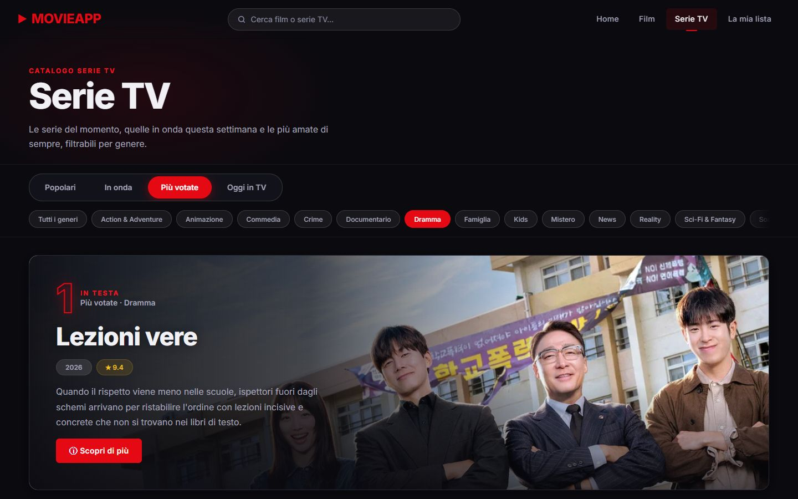
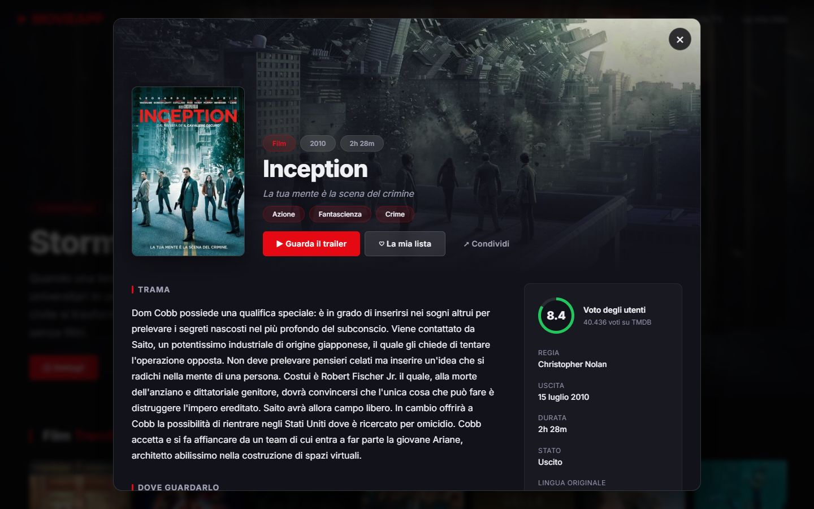
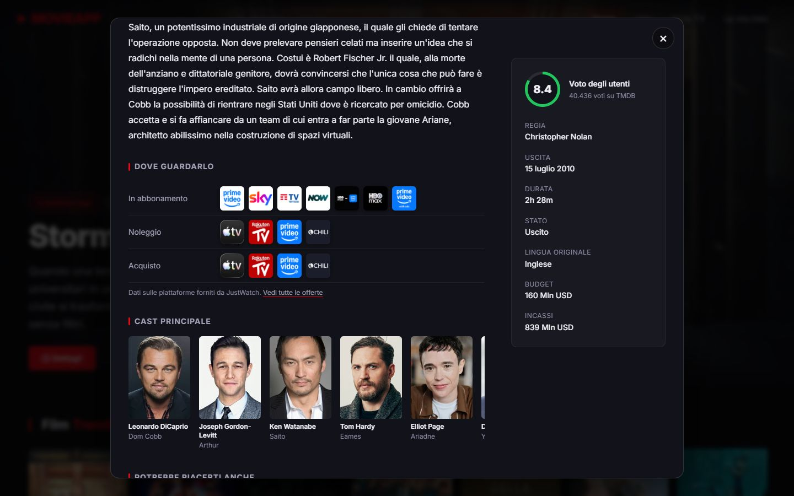
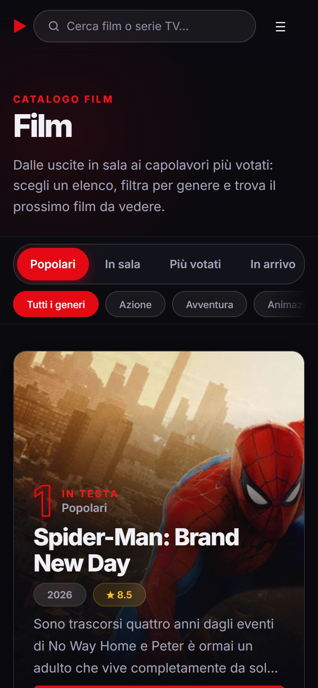
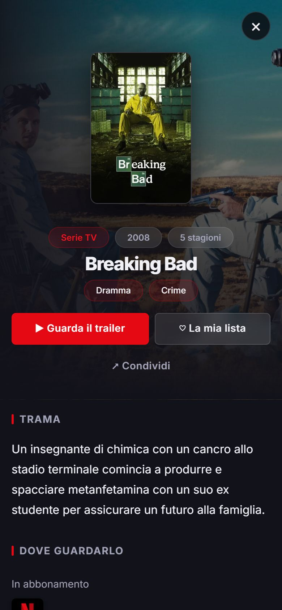

# movieApp 🎬

[](https://github.com/AlexandruD18/movieapp-dimofte/actions/workflows/ci.yml)

Web app in stile Netflix per esplorare film e serie TV con dati in tempo reale da [TMDB](https://www.themoviedb.org/).
È scritta in **HTML, CSS e JavaScript vanilla** (ES modules), senza framework né build step, ed è coperta da test unitari, end-to-end e di accessibilità.



| Catalogo film | Catalogo serie filtrato per genere |
|---|---|
|  |  |

| Dettaglio del titolo | Dove guardarlo, cast, scheda |
|---|---|
|  |  |

| Mobile: catalogo | Mobile: dettaglio |
|---|---|
|  |  |

---

## Funzionalità

- **Home**: hero a rotazione con i film del giorno, carousel di film e serie trending, griglia dei più votati
- **Catalogo Film e Serie TV**:
  - schede *Popolari / In sala / Più votati / In arrivo* per i film e *Popolari / In onda / Più votate / Oggi in TV* per le serie
  - filtro per **genere**, che si combina con la scheda scelta
  - **titolo in evidenza** in testa alla selezione, griglia con il resto e "Carica altri"
  - la selezione resta nell'URL (`movies.html?list=top_rated&genre=16`), quindi si può condividere o ricaricare
- **Ricerca live** nella navbar: suggerimenti con debounce, navigabile da tastiera (↑ ↓ Invio Esc)
- **Popup di dettaglio**:
  - anello del voto, generi, regia o autori, uscita, budget e incassi
  - **dove guardarlo in Italia** (abbonamento, noleggio, acquisto), con dati JustWatch
  - cast con foto, stagioni per le serie, trailer YouTube incorporato e titoli consigliati
  - pulsante per condividere
- **Link condivisibili**: `index.html#movie-27205` apre direttamente un titolo, e il **tasto indietro chiude il popup**
- **La mia lista**: preferiti nel `localStorage`, sincronizzati tra le schede aperte, con filtri e statistiche calcolate (voto medio, ore di visione)
- **Responsive e accessibile**: menu mobile, popup a schermo intero sui telefoni, navigazione da tastiera, focus visibile, WCAG 2 AA verificato con axe
- **Stati di caricamento ed errore**: skeleton, messaggi chiari (chiave non valida, rete assente, rate limit) e pulsante "Riprova"

## Scelte tecniche

| Tema | Cosa ho fatto |
|---|---|
| Architettura | ES modules, ognuno con un solo compito: `api.js` (rete), `catalog.js` (catalogo film e serie), `detail.js` (contenuto del popup), `modal.js` (ciclo di vita e cronologia), `favorites.js`, `layout.js` (header e ricerca comuni), più uno script per pagina |
| Catalogo | Senza genere ogni scheda usa il suo endpoint dedicato. Con un genere passa a `/discover` con criteri equivalenti (ordinamento, finestre di date, voti minimi), perché gli endpoint dedicati non filtrano per genere. Film e serie condividono lo stesso codice, configurato da una tabella |
| Rete | Cache delle richieste in memoria: hero e carousel condividono la stessa chiamata `/trending`. Gli errori non restano in cache, quindi "Riprova" rifà davvero la richiesta. Il dettaglio carica cast, video, piattaforme e consigliati in **una sola** richiesta con `append_to_response` |
| Race condition | Catalogo, ricerca e popup scartano le risposte arrivate dopo una richiesta più recente (ad esempio cambiando scheda mentre la lista precedente sta ancora arrivando) |
| Cronologia | Il popup aggiunge una voce alla cronologia: "indietro" lo chiude, e un titolo consigliato sostituisce la voce invece di accumularne |
| Accessibilità | Schede con il pattern ARIA `tablist` (frecce, Home, Fine), filtri con `aria-pressed`, `<dialog>` nativo per il popup, liste a scorrimento raggiungibili da tastiera |
| DOM | Event delegation (un solo listener per tutte le card, anche quelle caricate dopo). I dati esterni passano solo da `textContent`, mai da `innerHTML` |
| Piattaforma nativa | Container query per le card strette, `position: sticky` per la barra dei filtri, `srcset` per le immagini, `fetchpriority` per l'immagine LCP, `Intl` per date, lingue e valute |
| Segreti | La API key sta in `js/config.js`, escluso da git. In produzione viene iniettata da una secret di GitHub al momento del deploy |

## Qualità

- **53 test unitari** (Vitest + jsdom): formattazione, client API (cache, errori, chiave mancante), catalogo (URL ↔ stato, scelta della richiesta), preferiti, rendering del dettaglio
- **27 test end-to-end** (Playwright, desktop e mobile):
  - home, catalogo (schede, generi, URL, tastiera, risposte fuori ordine, lista vuota, errore e "Riprova")
  - popup (tastiera, tasto indietro, deep link, trailer, consigliati), ricerca, la mia lista
  - **scansioni di accessibilità axe** di tutte le pagine e del popup aperto
- I test E2E usano **risposte TMDB registrate** ([`scripts/record-fixtures.js`](scripts/record-fixtures.js)): veloci, ripetibili, e in CI non serve la API key
- **ESLint** e **html-validate** a ogni push. Il deploy su GitHub Pages parte solo se la CI passa
- **Lighthouse**: Performance 98 su desktop e circa 87 su mobile, Accessibilità 100, Best Practices 100, SEO 100

## Struttura

```
├── index.html, movies.html, series.html, profile.html
├── css/style.css            # design token (custom properties) + componenti
├── assets/                  # favicon, screenshot
├── js/
│   ├── api.js               # client TMDB: cache, errori, endpoint
│   ├── config-loader.js     # carica la API key esclusa da git
│   ├── catalog.js           # catalogo film/serie: schede, generi, in evidenza
│   ├── utils.js             # card, skeleton, stati di errore
│   ├── layout.js            # header, menu mobile, ricerca, click sulle card
│   ├── modal.js             # popup: apertura, hash nell'URL, tasto indietro
│   ├── detail.js            # contenuto del popup + funzioni di formattazione
│   ├── favorites.js         # "La mia lista" nel localStorage
│   └── pages/               # home.js, movies.js, series.js, profile.js
├── tests/
│   ├── unit/                # Vitest
│   └── e2e/                 # Playwright + fixture
├── scripts/record-fixtures.js
└── .github/workflows/       # ci.yml, deploy.yml
```

## Endpoint TMDB usati

| Pagina | Endpoint |
|---|---|
| Home | `/trending/movie/day`, `/trending/tv/day`, `/movie/top_rated` |
| Film | `/movie/popular`, `/movie/now_playing`, `/movie/top_rated`, `/movie/upcoming`; con un genere `/discover/movie`; `/genre/movie/list` |
| Serie TV | `/tv/popular`, `/tv/on_the_air`, `/tv/top_rated`, `/tv/airing_today`; con un genere `/discover/tv`; `/genre/tv/list` |
| Dettaglio | `/movie/{id}`, `/tv/{id}` con `append_to_response=credits,videos,watch/providers,recommendations` |
| Ricerca | `/search/multi` |

Tutte le chiamate sono `GET`, con `language=it-IT`.

## Avvio in locale

1. Richiedi una API key gratuita (v3) su [themoviedb.org](https://www.themoviedb.org/settings/api)
2. Copia `js/config.example.js` in `js/config.js` e inserisci la chiave
3. Installa gli strumenti di sviluppo e avvia il server (i moduli ES non funzionano con `file://`):

```bash
npm install
npm run dev          # http://127.0.0.1:4173
```

| Comando | Cosa fa |
|---|---|
| `npm run lint` | ESLint + validazione HTML |
| `npm test` | Test unitari |
| `npm run test:e2e` | Test end-to-end e di accessibilità |
| `npm run check` | Tutto quanto sopra |
| `node scripts/record-fixtures.js` | Riregistra le risposte TMDB usate dai test E2E |

## Deploy

[`deploy.yml`](.github/workflows/deploy.yml) pubblica il sito su GitHub Pages dopo che la CI è passata su `master`:

1. **Settings → Secrets and variables → Actions**: aggiungi la secret `TMDB_API_KEY`
2. **Settings → Pages → Source**: seleziona **GitHub Actions**

In un sito solo frontend la chiave resta comunque visibile nelle richieste del browser. Per una chiave TMDB di sola lettura è accettabile; per nasconderla servirebbe un piccolo proxy lato server.

## Origine del progetto

È nato come progetto d'esame del corso *Introduzione allo sviluppo frontend* ([traccia](docs/TRACCIA-ESAME.md)). Poi l'ho esteso con catalogo filtrabile, ricerca, dettaglio, lista personale, accessibilità, test automatici e CI/CD.

## Autore

**Alexandru Dimofte** · [GitHub](https://github.com/AlexandruD18)

---

<sub>Questo prodotto usa l'API di TMDB ma non è approvato né certificato da TMDB. Dati sulle piattaforme di streaming forniti da JustWatch.</sub>
